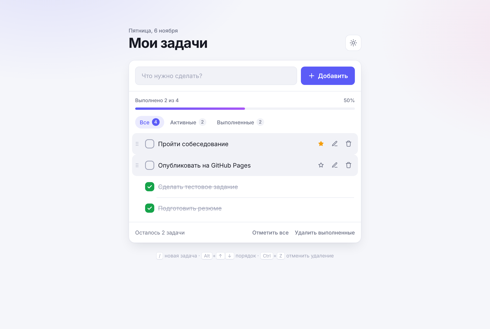
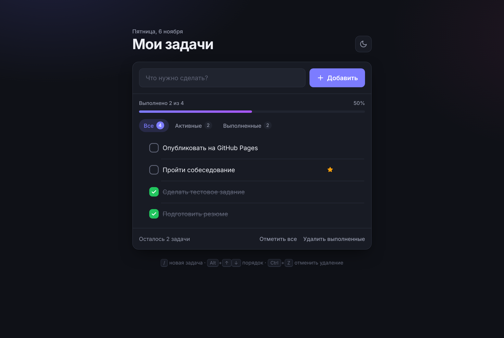
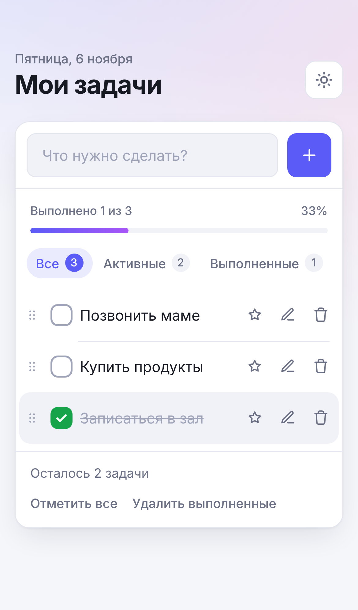

# ✅ Список задач (To-Do List)

[](https://github.com/egacoder/todo-list/actions/workflows/deploy.yml)

Аккуратный и быстрый список задач на чистом HTML, CSS и JavaScript. Без фреймворков и сборки, работает офлайн.

**🔗 Рабочий сайт: https://egacoder.github.io/todo-list/**



## Возможности

**Основной функционал из задания**

- **Добавление задач:** через поле ввода, клавишей `Enter` или кнопкой «Добавить». Пустой ввод не принимается, приложение показывает подсказку.
- **Отметка выполненных:** анимированный чекбокс, выполненная задача зачёркивается.
- **Удаление:** одной задачи или всех выполненных сразу, с возможностью **отменить**.
- **Сохранение после перезагрузки:** задачи хранятся в `localStorage`.

**Дополнительно**

- ↕️ **Перетаскивание** задач мышью или пальцем, а с клавиатуры — `Alt`+`↑`/`↓`.
- ⭐ **Важные задачи** со звёздочкой.
- ✏️ **Редактирование** двойным кликом или кнопкой (`Enter` сохраняет, `Esc` отменяет).
- 🔎 **Фильтры** «Все / Активные / Выполненные» со счётчиками. Выбор запоминается.
- ☑️ **«Отметить все»** одной кнопкой и 🎉 конфетти, когда выполнены все задачи.
- 📊 **Прогресс** выполнения и счётчик с правильным склонением («1 задача», «3 задачи», «5 задач»).
- 🌗 **Светлая и тёмная тема:** по умолчанию следует системной, выбор сохраняется.
- 📴 **Офлайн-режим и установка как приложение (PWA):** сервис-воркер кэширует сайт.
- 🔄 **Синхронизация между вкладками:** изменения в одной вкладке сразу видны в другой.
- ⌨️ **Горячие клавиши:** `/` — новая задача, `Ctrl`+`Z` — отменить удаление.
- 📱 **Адаптивная вёрстка:** на телефоне кнопки всегда видны и удобны для пальца.

| Тёмная тема | Мобильная версия |
|---|---|
|  |  |

## Качество и надёжность

- **Безопасность.**
  - Пользовательский текст выводится только через `textContent`, поэтому XSS исключён. Это проверяет тест.
  - Строгая **Content Security Policy**: никаких inline-скриптов и стилей, ресурсы загружаются только с разрешённых источников.
- **Устойчивость.**
  - Повреждённые данные в `localStorage` не ломают приложение: невалидные записи и дубликаты отбрасываются.
  - Если хранилище заблокировано (запрет cookies), приложение продолжает работать в памяти и предупреждает об этом.
  - Отмена удаления возвращает задачу на прежнее место и не стирает изменения, сделанные после удаления.
- **Доступность (a11y).**
  - Полное управление с клавиатуры, включая перестановку задач.
  - `aria`-атрибуты и объявления для скринридеров.
  - Видимый фокус и его корректное восстановление после действий.
  - Поддержка `prefers-reduced-motion`. Уведомления не исчезают, пока на них наведён курсор или фокус.
- **Архитектура.**
  - Бизнес-логика (`js/store.js`) состоит из чистых функций без мутаций и не зависит от DOM.
  - Интерфейс (`js/app.js`) только отрисовывает состояние и обрабатывает события.
  - Перетаскивание (`js/sortable.js`) и конфетти (`js/confetti.js`) вынесены в отдельные модули.
- **Тесты.**
  - **44 модульных** теста на встроенном `node:test`.
  - **24 браузерных** сценария на Playwright: десктоп и мобильная версия, офлайн-режим, синхронизация вкладок, регрессии найденных ошибок. Каждый тест дополнительно проверяет, что в консоли нет ошибок.
- **CI/CD.** GitHub Actions на каждый push запускает оба набора тестов и только после их успеха публикует сайт на GitHub Pages.

## Структура проекта

```
├── index.html              # разметка и шаблон задачи
├── css/style.css           # стили, темы, анимации
├── js/
│   ├── store.js            # чистая логика: задачи, фильтры, отмена, порядок, хранилище
│   ├── app.js              # интерфейс: отрисовка, события, горячие клавиши, тема
│   ├── sortable.js         # перетаскивание (Pointer Events: мышь, палец, перо)
│   ├── confetti.js         # праздничный салют на canvas
│   └── theme.js            # применение темы до отрисовки (без «вспышки»)
├── sw.js                   # сервис-воркер для офлайн-режима
├── manifest.webmanifest    # манифест PWA
├── icons/                  # иконки приложения и превью для соцсетей
├── scripts/serve.js        # локальный сервер без зависимостей
├── tests/
│   ├── store.test.js       # модульные тесты
│   └── e2e/app.spec.js     # браузерные тесты
└── .github/workflows/      # тесты и деплой на GitHub Pages
```

## Запуск локально

Нужен Node.js 18 или новее.

```bash
git clone https://github.com/egacoder/todo-list.git
cd todo-list
npm start              # http://localhost:3000
```

Тесты:

```bash
npm test               # модульные тесты, без установки зависимостей
npm ci && npx playwright install chromium
npm run test:e2e       # браузерные тесты
```

Приложение использует ES-модули, поэтому его нужно открывать через локальный сервер, а не двойным кликом по `index.html`.

## Использованные AI-инструменты

Проект сделан с помощью **Claude Code** (CLI-агент от Anthropic). Работа шла так:

1. Я поставил задачу и требования к качеству: аккуратный дизайн, корректная работа, рабочий сайт.
2. Claude Code спроектировал архитектуру (логика отдельно от интерфейса), написал код, стили и тесты.
3. Затем прошёл ревью всего кода. Найденные ошибки сначала воспроизводились в браузере, потом исправлялись и закреплялись регрессионными тестами:
   - удаление терялось, если сразу после него совершить другое действие;
   - отмена удаления стирала изменения, сделанные после удаления;
   - при заблокированном хранилище приложение не запускалось;
   - задачу нельзя было перетащить в самый конец списка.
4. Дизайн доработан по скриншотам десктопной и мобильной версий. Затем настроены CI и автоматическая публикация на GitHub Pages.

## Лицензия

[MIT](LICENSE)
